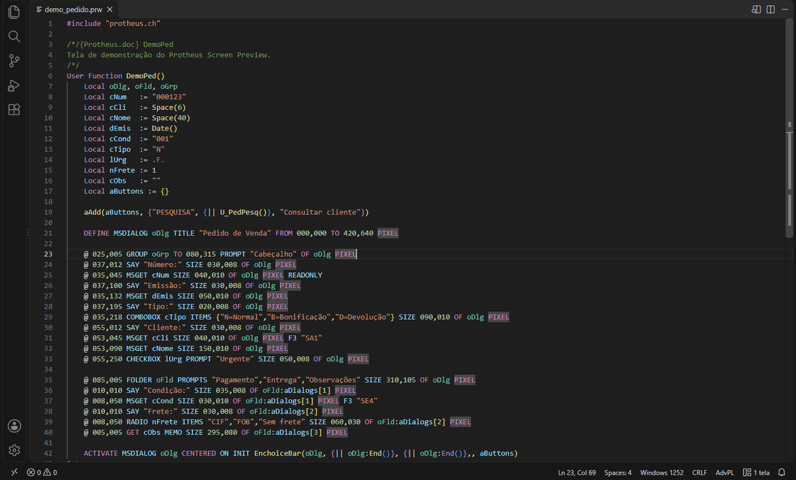
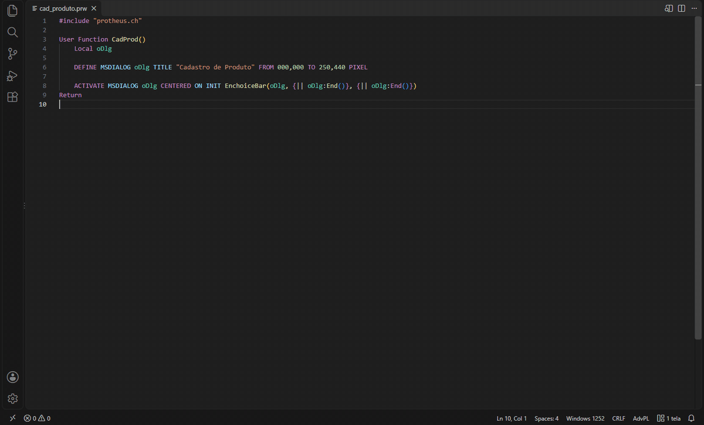

# Protheus Screen Preview

Veja como fica a tela enquanto escreve o código. A extensão desenha, num painel ao lado do editor, as telas clássicas em **AdvPL/TLPP (TOTVS Protheus)** com a aparência do **SmartClient WebApp**, **sem compilar e sem abrir o SmartClient**.

Na prévia também dá para **montar a tela**: arrastar controles da paleta, mover, redimensionar e trocar textos. A extensão grava no fonte só o que mudou, no estilo do próprio fonte.

> Ferramenta da comunidade, sem vínculo com a TOTVS. Protheus, AdvPL e TLPP são marcas da TOTVS S.A.

### Prévia ao lado do código

Clicar num controle leva à linha dele; arrastar muda só os números no fonte; digitar no fonte atualiza a prévia.

### Montar a tela pela paleta

Arraste Texto, Campo, Botão e os demais controles para a tela. O código sai no estilo do fonte, com as variáveis declaradas como `Local`, e o painel de propriedades troca textos, tamanhos e `Align`.

### Miniatura no hover

Passe o mouse sobre um controle ou sobre o `DEFINE MSDIALOG` para ver posição, tamanho, avisos e uma miniatura da tela.

## Como usar

1. Abra um fonte `.prw`, `.prx`, `.tlpp`, `.aph`, `.prg` ou `.apw`.
2. Pressione `Ctrl+Shift+V` (`Cmd+Shift+V` no macOS) ou clique no ícone da prévia na barra de título do editor.
3. Pronto: a prévia acompanha o cursor e se atualiza enquanto você digita.

Na barra da prévia ficam o seletor de diálogo (quando o fonte tem mais de um), o zoom, a grade, o tema, **Exportar**, **Propriedades**, **Ordem de foco** e **Condições**.

## Recursos

**Prévia**
- Telas escritas com comandos (`DEFINE MSDIALOG`, `@ ... SAY`, `MSGET`, `BUTTON`...) ou com classes (`MsDialog`, `TSay`, `TGet`, `TButton`...), inclusive misturados.
- `Align`, abas do `TFolder`, `FWLayer`, `TSplitter`, `TScrollBox` e a barra da `EnchoiceBar` com seus botões.
- Coordenadas calculadas com variáveis, contas, `#define` (do fonte e dos `.ch` do workspace), laços `For`/`While` e funções do próprio fonte.
- `If` e `Do Case`: quando a condição depende de um parâmetro, o botão **Condições** escolhe qual ramo mostrar.
- Vários diálogos no mesmo fonte: a prévia mostra o diálogo onde está o cursor.
- O que não dá para calcular aparece com contorno tracejado e ⚠ (posição estimada).

**Montar e editar a tela**
- **Paleta**: arraste Texto, Campo, Botão, Caixa, Combo, Rádio, Lista, Memo, Grupo, Painel, Pastas ou Grade para a tela ou para dentro de um painel/aba.
- **Mover e redimensionar** com o mouse, com encaixe na grade e guias que alinham com os controles vizinhos.
- **Painel de propriedades**: linha, coluna, largura, altura, texto, itens e `Align`.
- **Alinhar e distribuir** vários controles de uma vez.
- **Nova tela**: o comando *Nova tela (modelo)* cria uma tela pronta (simples com OK/Cancelar, cadastro com MsMGet, FWLayer em duas colunas ou pastas).
- Cada alteração vira uma única ação de desfazer (`Ctrl+Z`) no editor.

**Atalhos na prévia**

| Atalho | Ação |
|---|---|
| Setas | Move o controle selecionado 1 unidade (`Shift`: um passo da grade) |
| `Shift` + clique | Seleciona vários controles |
| `Alt` ao arrastar | Solta sem encaixe na grade e nas guias |
| `Delete` | Exclui o controle (e os filhos, depois de confirmar) |
| `Ctrl+D` | Duplica |
| `Ctrl+C` / `Ctrl+V` | Copia e cola controles (no painel ou aba selecionado) |
| `Ctrl` + roda do mouse | Zoom |

**Avisos e correções**
- Avisos na aba Problemas: controles sobrepostos, fora da tela, texto maior que o campo, quase alinhados, sem botão de saída e ordem de foco fora de ordem (lista abaixo).
- Correção automática pela lâmpada (`Ctrl+.`): alinhar ao vizinho, aumentar a largura, trazer para dentro da tela e inserir um botão Fechar ou uma `EnchoiceBar`.

**Outros**
- **Ordem de foco**: numera os controles na ordem do Tab.
- **Exportar** a tela como PNG ou SVG.
- **Controles da tela**: árvore no Explorer com diálogos, painéis, abas e controles.
- **Barra de status** com o número de telas e de avisos do fonte.
- **Tema claro ou escuro** da tela desenhada.
- Snippets `telacmd`, `telacls` e `btncmd` (com a linguagem `advpl` do TOTVS Developer Studio).

## Comandos

| Comando | O que faz |
|---|---|
| `Protheus Screen Preview: Abrir prévia` | Abre a prévia do fonte ativo |
| `Protheus Screen Preview: Nova tela (modelo)` | Cria uma tela a partir de um modelo |
| `Protheus Screen Preview: Escolher diálogo` | Escolhe qual diálogo do arquivo mostrar |
| `Protheus Screen Preview: Alternar tema claro/escuro da prévia` | Alterna o tema da tela desenhada |
| `Protheus Screen Preview: Exportar a tela como imagem (PNG/SVG)` | Salva a tela exibida como imagem |
| `Protheus Screen Preview: Atualizar` | Relê as configurações e os includes |

## Configurações

| Configuração | Padrão | Descrição |
|---|---|---|
| `advplScreenPreview.theme` | `auto` | Tema da tela desenhada: `auto` (segue o VS Code), `light` ou `dark` |
| `advplScreenPreview.showGrid` | `true` | Mostra a grade |
| `advplScreenPreview.gridSize` | `5` | Espaçamento da grade e passo do encaixe |
| `advplScreenPreview.smartGuides` | `true` | Guias de alinhamento ao arrastar |
| `advplScreenPreview.enchoiceBarPosition` | `top` | Onde a `EnchoiceBar` é desenhada (`top` ou `bottom`) |
| `advplScreenPreview.hover.enabled` | `true` | Hover com posição, avisos e miniatura |
| `advplScreenPreview.statusBar.enabled` | `true` | Telas e avisos na barra de status |
| `advplScreenPreview.includePaths` | `[]` | Pastas extras com arquivos `.ch` |
| `advplScreenPreview.alignmentTolerance` | `2` | Diferença máxima para o aviso de "quase alinhado" |
| `advplScreenPreview.rules.ASP001` … `ASP007` | `true` | Liga ou desliga cada aviso |
| `advplScreenPreview.debounce` | `300` | Espera (ms) antes de atualizar ao digitar |
| `advplScreenPreview.dialogCoordinateFactor` | `2` | Telas com `PIXEL`: pixels por unidade de coordenada |
| `advplScreenPreview.charWidth` / `charHeight` | `16` / `26` | Telas sem `PIXEL`: pixels por coluna e por linha |
| `advplScreenPreview.usePPO` | `false` | Usa o PPO do TOTVS Developer Studio (ver abaixo) |

## Avisos

| Código | Aviso |
|---|---|
| ASP001 | Controles sobrepostos |
| ASP002 | Controle fora da área útil do diálogo ou do painel |
| ASP003 | Texto provavelmente maior que o tamanho do controle |
| ASP004 | Controles quase alinhados (coluna ou linha) |
| ASP005 | Posição estimada (coordenada que não dá para calcular) |
| ASP006 | Diálogo sem botão de saída |
| ASP007 | Ordem de foco (Tab) voltando para um controle que aparece antes na tela |

## TOTVS Developer Studio

Funciona com ou sem a extensão oficial **TOTVS Developer Studio**. Com ela instalada, os fontes ganham cores e os snippets ficam disponíveis.

Opcional: com o TDS conectado a um servidor, ligue `advplScreenPreview.usePPO` para a prévia usar o fonte pré-processado pelo servidor ao salvar. Nesse modo a prévia é somente leitura.

## Limitações

- A prévia mostra a disposição dos controles, não o pixel exato: navegador, zoom e resolução variam.
- A aparência é a do **SmartClient WebApp**.
- Telas montadas em tempo de execução (funções de outros fontes, laços sem contador) aparecem aproximadas e marcadas com ⚠.
- `MsMGet` e `Enchoice` aparecem como área reservada, porque os campos vêm do dicionário de dados.
- Telas **MVC** (`FWFormView`) não são desenhadas.
- As cores do tema escuro são uma aproximação.

## Privacidade

A extensão não envia dados, não acessa a rede e não tem telemetria. Ao editar pela prévia, ela altera só os trechos necessários do fonte e preserva o encoding (CP1252).

## Autor e contato

Desenvolvido por **André Lanzieri**.

- E-mail: [andrelanzieri@hotmail.com](mailto:andrelanzieri@hotmail.com)
- LinkedIn: [linkedin.com/in/andre-lanzieri-30663642](https://www.linkedin.com/in/andre-lanzieri-30663642/)
- Dúvidas, erros e sugestões: [issues do repositório](https://github.com/andrelanzieri/protheus-screen-preview/issues)

Licença [MIT](LICENSE).
