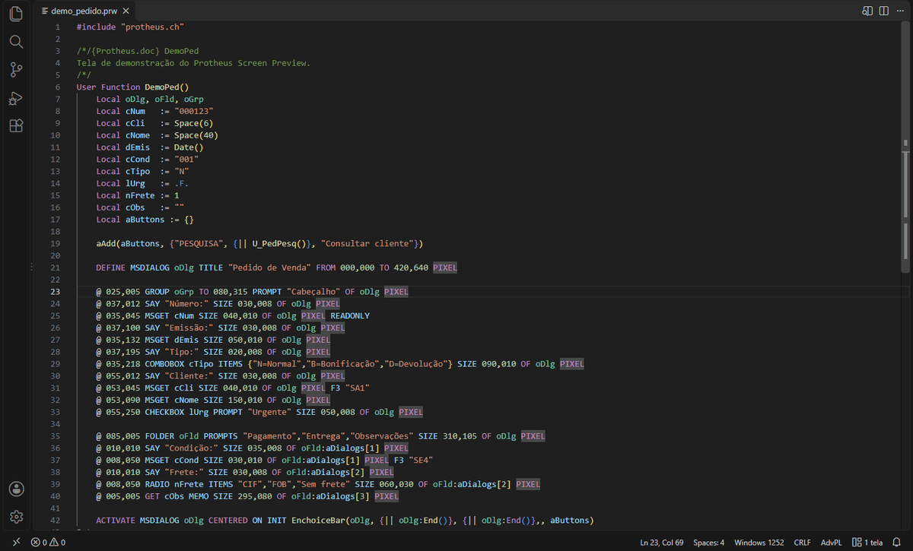

# Protheus Screen Preview

Prévia visual, num painel ao lado do editor, das telas clássicas escritas em **AdvPL/TLPP (TOTVS Protheus)**. As coordenadas são lidas direto do código-fonte, **sem compilar e sem abrir o SmartClient**, e a aparência imita o **SmartClient WebApp**.

Na prévia também dá para **montar a tela**: arrastar controles da paleta, mover, redimensionar e trocar textos. A extensão grava no fonte só o que mudou, no estilo do próprio fonte.

> Ferramenta da comunidade, sem vínculo com a TOTVS. Protheus, AdvPL e TLPP são marcas da TOTVS S.A.

### Prévia ao lado do código

Clicar num controle leva à linha dele; arrastar muda só os números no fonte; digitar no fonte atualiza a prévia.

### Montar a tela pela paleta

Arraste Texto, Campo, Botão e os demais controles para a tela. O código sai no estilo do fonte, com as variáveis declaradas como `Local`, e o painel de propriedades troca textos, tamanhos e `Align`.

### Miniatura no hover

Passe o mouse sobre um controle ou sobre o `DEFINE MSDIALOG` para ver posição, tamanho, avisos e uma miniatura da tela.

## O que faz

- **Lê as duas sintaxes** e gera um único modelo:
  - comandos: `DEFINE MSDIALOG`, `ACTIVATE MSDIALOG`, `@ ... SAY | MSGET | GET | BUTTON | CHECKBOX | COMBOBOX | RADIO | GROUP | LISTBOX | MULTIGET | BITMAP | FOLDER | BROWSE`, `DEFINE SBUTTON`;
  - classes: `MsDialog`, `TDialog`, `TSay`, `TGet`, `TButton`, `TCheckBox`, `TComboBox`, `TRadMenu`, `TGroup`, `TListBox`, `TWBrowse`, `TCBrowse`, `TMultiGet`, `TBitmap`, `TPanel`, `TFolder`, `MsNewGetDados`, `FWBrowse`, `FWMarkBrowse`, `TSimpleEditor`, `TScrollBox`, `TSplitter`, `TMeter`, `TBtnBmp2`, `FWLayer` (`Init`, `AddLine`, `AddCollumn`, `AddWindow`, `getColPanel`, `getWinPanel`), `EnchoiceBar`, `MsMGet` e `Enchoice`.
- **Calcula coordenadas**: literais, `+ - * /`, `Int()`, variáveis locais (`:=`, `+=`, `-=`, `++`), `#define` do fonte e dos `.ch` do workspace, `oDlg:nClientWidth/nClientHeight` e `Static`/`User Function` do próprio fonte que só calculam um valor (`Local`, atribuições e `Return`). Funções auxiliares que criam controles (`CriaBotao(oDlg, 070, 110, "OK")`) são expandidas na tela que as chama, com os argumentos de cada chamada; esses controles aparecem, mas ficam bloqueados para edição pela prévia, porque o código está na função e vale para todas as chamadas. Laços `For` e `While` com contador são desdobrados (até 50 voltas). O que não dá para calcular aparece com **contorno tracejado e ⚠ ("posição estimada")**.
- **`If/ElseIf/Else` e `Do Case`**: condição calculável escolhe o ramo; condição desconhecida (parâmetro, função) mostra todos os ramos, com uma faixa roxa nos controles condicionais. O botão **Condições** escolhe o ramo de cada `If`/`Do Case`, e o layout (`Align`) é refeito só com os controles daquele ramo. O ASP001 não acusa sobreposição entre ramos que nunca aparecem juntos.
- **Comandos** também: `@ ... METER`, `@ ... SCROLLBOX` (SIZE altura,largura) e `@ ... BTNBMP`. O `TBtnBmp2` usa pixels reais de tela (sem o fator do PIXEL); os filhos de um `TSplitter` dividem o espaço em partes iguais (`SetOrient(1)` = vertical).
- **Layout como no SmartClient**: `Align` (TOP, BOTTOM, LEFT, RIGHT, ALLCLIENT) empilhado na ordem de criação, abas do `TFolder` (clique para trocar), porcentagens do `FWLayer`, barra da `EnchoiceBar` com os botões extras.
- **`MsMGet`/`Enchoice`** aparecem como **área reservada** ("MsMGet · SA1"), com os campos do array literal listados só como informação. A extensão não lê o dicionário de dados.
- **Vários diálogos por arquivo**: mostra o diálogo onde está o cursor, e um seletor permite trocar.
- **Sincronização**: clicar num controle leva o cursor à linha dele (com destaque), e mover o cursor no fonte seleciona o controle na prévia. A TreeView **"Controles da tela"** (Explorer) mostra a hierarquia diálogo → painel/aba → controle.
- **Edição visual**: arrastar, redimensionar (alças), encaixe na grade e **guias inteligentes** nas bordas e centros dos vizinhos (segure `Alt` para desligar os dois), setas do teclado (1 unidade; `Shift` = passo da grade), seleção múltipla com `Shift` e as ações alinhar esquerda/direita/topo/base, mesma largura/altura e distribuir horizontal/vertical. **Cada ação é um único `Ctrl+Z`.**
- **Criar e remover controles pela prévia**:
  - **Paleta** à esquerda: arraste Texto, Campo, Botão, Caixa, Combo, Rádio, Lista, Memo, Grupo, Painel, Pastas ou Grade para a tela (ou para dentro de um painel/aba); o controle encaixa na grade e nas guias dos vizinhos (`Alt` desliga). O código sai no estilo do fonte (comandos `@` ou classes, zeros à esquerda, indentação) e as variáveis novas são declaradas como `Local` no início da função.
  - `Delete` exclui o controle (com os filhos, depois de confirmar, e os comandos `oX:...` dele). A variável fica no `Local`.
  - `Ctrl+D` duplica (um passo da grade para baixo e para a direita, com variáveis renomeadas: `oBtn1` → `oBtn2`).
  - `Ctrl+C` copia o código dos controles; `Ctrl+V` na prévia cola no painel ou aba selecionado (trocando o `OF`), no mesmo fonte. No editor, `Ctrl+V` cola o código.
  - Controles de laço, partes do FWLayer e a EnchoiceBar não são excluídos nem duplicados pela prévia.
- **Painel de propriedades** à direita: linha, coluna, largura, altura, texto, itens/abas e `Align` do controle selecionado (ou dos selecionados). Campo que não vem de um literal fica desabilitado, com o motivo.
- **Ordem de foco**: o botão **Ordem de foco** numera os controles focáveis na ordem de criação, que é a ordem do Tab.
- **Nova tela**: o comando *Nova tela (modelo)* gera uma função com diálogo nas duas sintaxes (simples com OK/Cancelar, cadastro com MsMGet, FWLayer em duas colunas ou pastas), no fim do fonte ativo ou num arquivo novo, e abre a prévia. Com o TDS instalado (linguagem `advpl`), há também os snippets `telacmd`, `telacls` e `btncmd`.
- **Validações** na aba Problemas (ASP001–ASP007), com **correção automática** (lâmpada / `Ctrl+.`): alinhar à coluna ou linha do vizinho (ASP004, também "alinhar todos" do arquivo), aumentar a largura para o texto caber (ASP003), trazer o controle para dentro da área útil (ASP002) e inserir um botão Fechar ou um EnchoiceBar no `ON INIT` (ASP006). Só literais numéricos são alterados; coordenada calculada não recebe correção.
- **Hover no fonte**: sobre a linha de um controle aparecem tipo, posição e tamanho (no código e em px), motivo de bloqueio, avisos daquele controle e uma miniatura da tela com o controle destacado.
- **Exportar a tela** como PNG (2x) ou SVG, com a aba e o tema atuais: botão **Exportar** na prévia ou o comando *Exportar a tela como imagem*.
- **Barra de status** com o número de telas e de avisos do fonte ativo; o clique abre a prévia.
- A prévia **reabre sozinha** depois de recarregar a janela, no mesmo arquivo e diálogo.
- **Tema claro/escuro** da tela desenhada, sem mudar tamanhos nem posições.

## Como usar

1. Abra um fonte `.prw`, `.prx`, `.tlpp`, `.aph`, `.prg` ou `.apw`.
2. Rode **Protheus Screen Preview: Abrir prévia**: `Ctrl+Shift+V` (`Cmd+Shift+V` no macOS), que só vale para fontes AdvPL e não conflita com o Markdown, ou o ícone na barra de título do editor.
3. Na barra da prévia: seletor de diálogo, zoom (50% a 300%; `Ctrl` + roda do mouse também funciona), grade, tema e ações de alinhamento.
4. Passe o mouse sobre um controle para ver tipo, linha, coluna, largura, altura, variável vinculada, linha do fonte e, se for o caso, por que ele não pode ser arrastado.

### Comandos

| Comando | Descrição |
|---|---|
| `Protheus Screen Preview: Abrir prévia` | Abre a prévia do fonte ativo |
| `Protheus Screen Preview: Nova tela (modelo)` | Gera uma tela a partir de um modelo |
| `Protheus Screen Preview: Escolher diálogo` | Escolhe qual diálogo do arquivo mostrar |
| `Protheus Screen Preview: Alternar tema claro/escuro da prévia` | Alterna o tema só nesta sessão |
| `Protheus Screen Preview: Exportar a tela como imagem (PNG/SVG)` | Salva o diálogo exibido como PNG ou SVG |
| `Protheus Screen Preview: Atualizar` | Relê configurações e includes e reprocessa |

### Configurações

| Configuração | Padrão | Descrição |
|---|---|---|
| `advplScreenPreview.debounce` | `300` | Atraso (ms) para atualizar a prévia e os diagnósticos ao digitar |
| `advplScreenPreview.theme` | `auto` | `auto` (segue o VS Code), `light` ou `dark`. O botão da prévia muda só a sessão |
| `advplScreenPreview.dialogCoordinateFactor` | `2` | Com `PIXEL`: px de tela por unidade de controle (o `FROM/TO` do diálogo é o dobro) |
| `advplScreenPreview.charWidth` / `charHeight` | `16` / `26` | Sem `PIXEL`: px por coluna/linha de caractere do SAY/GET (medido no WebApp) |
| `advplScreenPreview.gridSize` | `5` | Espaçamento da grade e passo do encaixe (unidades) |
| `advplScreenPreview.showGrid` | `true` | Mostra a grade |
| `advplScreenPreview.smartGuides` | `true` | Guias inteligentes ao arrastar |
| `advplScreenPreview.enchoiceBarPosition` | `top` | Posição da `EnchoiceBar` (`top`/`bottom`) |
| `advplScreenPreview.usePPO` | `false` | Usa o PPO do TDS (ver abaixo) |
| `advplScreenPreview.includePaths` | `[]` | Pastas extras com `.ch` |
| `advplScreenPreview.alignmentTolerance` | `2` | Tolerância do ASP004 (unidades) |
| `advplScreenPreview.hover.enabled` | `true` | Hover com posição, avisos e miniatura da tela |
| `advplScreenPreview.statusBar.enabled` | `true` | Item da barra de status com telas e avisos |
| `advplScreenPreview.rules.ASP001` … `ASP007` | `true` | Liga/desliga cada regra |

### Validações (aba Problemas, fonte "Protheus Screen Preview")

| Código | Regra |
|---|---|
| ASP001 | Controles sobrepostos (ignora pai/filho, como um GROUP com seus controles) |
| ASP002 | Controle fora da área útil do diálogo ou do painel pai |
| ASP003 | Texto do SAY/botão provavelmente maior que o SIZE (estimado pela fonte do WebApp) |
| ASP004 | Desalinhamento: coluna ou linha quase iguais (tolerância configurável) |
| ASP005 | Posição estimada (coordenada não calculável) |
| ASP006 | Diálogo sem botão de saída (`oDlg:End()`, `EnchoiceBar`, `SBUTTON` tipo 1/2...) |
| ASP007 | Ordem de foco (Tab) volta para um controle que aparece antes na tela: acima e não à direita, ou na mesma linha mais à esquerda. Subir para outra coluna à direita não conta (formulário em colunas) |

## Validar a prévia no Protheus

O fonte [samples/ASPVALID.prw](samples/ASPVALID.prw) traz telas de teste para conferir a prévia com o SmartClient WebApp. Elas cobrem comandos e classes, telas sem PIXEL, `Align`, `TFolder`, `FWLayer`, `EnchoiceBar`, grades, as classes adicionais, larguras de texto, `MsMGet`, `If/Case` e funções auxiliares.

1. Compile `samples/ASPVALID.prw` no RPO de um ambiente de testes.
2. Rode `U_ASPVALID`, por exemplo em Fórmulas, num item de menu ou como programa inicial do SmartClient. A tela T11 (MsMGet) precisa de empresa/filial abertas.
3. No menu **[ASP-MENU]**, abra uma tela (duplo clique ou **Abrir**) ou use **Abrir todas** para ver uma depois da outra.
4. Tire um print da janela inteira, com a barra de título. O identificador **[ASP-Txx]** está no título e também num comentário `// [ASP-Txx]` acima da função que monta a tela.
5. No VS Code, abra a prévia com o cursor na função da tela e compare com o print.

Na T12, a prévia mostra os dois ramos até você escolher um em **Condições**: `nOpc == 3` corresponde à T12a e `nOpc == 4` à T12b.

## Compatibilidade com o TDS

- A extensão **não registra** linguagem, gramática nem language server. Funciona com ou sem a extensão oficial **TOTVS Developer Studio** (`TOTVS.tds-vscode`) e não declara dependência de nenhuma extensão.
- É ativada por `onLanguage:advpl` e pela presença de fontes AdvPL no workspace.
- **PPO (opcional)**: com o TDS instalado e conectado a um servidor, ligue `advplScreenPreview.usePPO`. Ao salvar, a extensão chama a API pública `generatePPO` do TDS e passa o fonte pré-processado ao mesmo parser de classes. Se a chamada falhar, a extensão volta ao parser próprio e só registra o motivo no Output "Protheus Screen Preview". **Sem o TDS, a opção fica sem efeito e a extensão avisa.** A prévia gerada a partir do PPO é somente leitura.

## Privacidade e segurança

Sem telemetria, sem acesso à rede e sem banco de dados. O webview tem CSP restritiva (`default-src 'none'`, scripts só com `nonce`) e `localResourceRoots` limitado à pasta `media/`. Toda escrita no fonte é feita por `WorkspaceEdit`, trocando só os trechos numéricos necessários. O arquivo nunca é regravado inteiro e o encoding (CP1252) é preservado.

## Licença e contato

Licença [MIT](LICENSE). Dúvidas, erros e sugestões: [issues do repositório](https://github.com/andrelanzieri/protheus-screen-preview/issues).
